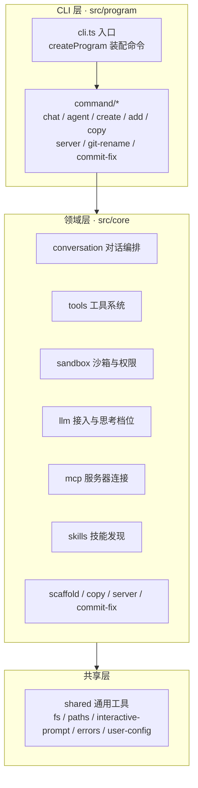
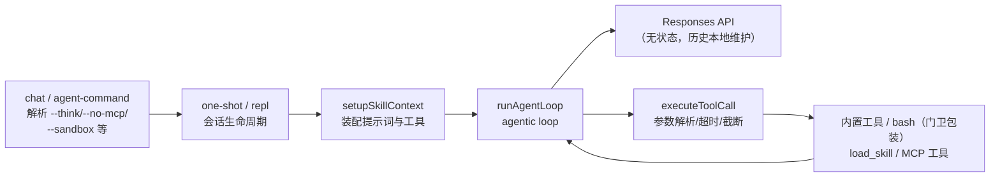
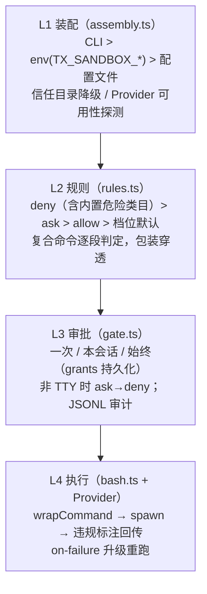

# 项目架构

> tx-cli：一个 Node.js 命令行工具，支持创建项目、添加模块、与大模型对话（含工具调用与沙箱管控）以及若干实用命令。

## 技术栈

| 类别      | 选型                                                  |
| ------- | --------------------------------------------------- |
| 语言与运行时  | TypeScript（ESM）+ Node.js ≥ 20.11                    |
| CLI 框架  | commander                                           |
| LLM 协议  | OpenAI 兼容 Responses API（`openai` SDK）               |
| 工具生态    | Model Context Protocol（`@modelcontextprotocol/sdk`） |
| 沙箱      | `@anthropic-ai/sandbox-runtime`（可插拔，见「沙箱与权限」）       |
| 构建 / 测试 | rollup / vitest                                     |
| 包管理     | pnpm                                                |

## 分层总览



依赖方向自上而下：命令层只做参数解析与分流，业务逻辑在领域层，跨模块复用的纯工具在共享层。命令与执行体分离（如 `registerChatCommand` / `runChatAction`），便于脱离 commander 单测。

## 目录结构

```text
src/
├── cli.ts                     # 进程入口：装配 program 并接管退出码
├── program/                   # CLI 层：命令注册（仅参数解析与分流）
│   └── command/               #   每个命令一个文件
├── core/                      # 领域层（协议类型内聚在各模块 types.ts）
│   ├── conversation/          # 对话编排（chat / agent 命令共用机制，模式即配置）
│   │   ├── chat.ts            #   chat 命令实现：CHAT_MODE + one-shot（单次）/ repl（多轮）入口
│   │   ├── agent.ts           #   agent 命令实现：AGENT_MODE + one-shot（单次）/ repl（多轮）入口
│   │   └── common/            #   会话机制：agentic loop、Responses 适配、
│   │                          #   流式渲染、技能装配（skill-context）
│   ├── tools/                 # 工具系统
│   │   ├── types.ts           #   Tool 接口（含 permission 权限声明、renderCall 调用渲染扩展点）
│   │   ├── executor.ts        #   执行器：参数解析、超时、8KB 截断
│   │   ├── permission.ts      #   权限门卫包装层（wrapToolWithPermission）
│   │   └── builtin/           #   内置工具：read_file / list_dir / glob /
│   │                          #   grep / web_search / write_todos（agent 模式装配，
│   │                          #   工厂创建）/ bash（工厂创建，按需拼入）
│   ├── sandbox/               # 沙箱与权限（四层模型，见下文）
│   │   └── providers/         #   srt（sandbox-runtime 适配）/ noop（直通）/
│   │                          #   landlock（外部 helper 方案）
│   ├── llm/                   # LLM 接入：client、config 向导、thinking 适配（含档位解析）
│   ├── mcp/                   # MCP：config 解析、manager 连接管理、tool-adapter
│   ├── skills/                # 技能：discovery 扫描、catalog、load_skill 工具
│   ├── scaffold/              # 脚手架：templates 加载、render 渲染（create/add 共用）
│   ├── copy/                  # copy 命令的复制实现
│   ├── server/                # server 命令的静态文件服务
│   └── commit-fix/            # commit-fix 命令的 ONES 消息转换
└── shared/                    # 共享层：fs / paths / interactive-prompt（交互问答封装）/
                               # errors / user-config / warnings / string / text
```

## 对话链路（chat / agent 命令）



关键设计：

- **无状态 Responses**：`store=false`，对话历史由本地维护、每轮全量发送；`instructions`（system 提示词）每轮重传。
- **工具装配**：内置工具（静态清单）+ `load_skill`（仅存在技能时）+ `write_todos`（agent 模式）+ bash（沙箱启用时）+ MCP 工具（连接成功时），在 `setupSkillContext` 一次性拼装，不支持运行时动态注册。
- **任务清单**（agent 模式）：`write_todos` 全量替换式维护会话内计划（对标 TodoWrite），状态存工具实例闭包、不持久化；调用提示经 `renderCall` 扩展点渲染为清单视图（☐ 待办 / ◐ 进行中 / ☑ 完成），REPL 以 `/todos` 查看。
- **MCP 与沙箱同生命周期**：随会话创建、`finally` 中统一释放。
- **失败隔离**：REPL 中单轮业务错误只提示不终止会话。
- **工具调用轮数上限按模式配置**：`ConversationModeConfig.maxIterations`，chat 8 轮、agent 20 轮（未指定回退 loop 默认 `DEFAULT_MAX_ITERATIONS`）；达到上限后软收敛为直接作答，经 `onSoftConverge` 回调黄字提示，避免用户不知情。

## 深度思考（thinking）处理方案

深度思考的协议差异统一收敛在 `core/llm/thinking.ts` 适配层，对话编排层只面向统一的「档位」概念。

### 档位模型

四档思考强度：`off` / `low` / `medium` / `high`，取值优先级：

```text
命令行 --think  >  配置文件 llm.thinkingLevel  >  内置默认 medium
```

- 档位校验前置（`parseThinkingLevel`）：非法值在对话开始前报错退出，不带着错误配置发请求。
- REPL 中可用 `/think` 内联命令会话内切换（无参查看、带参下一轮生效）。

### 协议风格适配

不同服务对思考字段的协议互不兼容，适配层按「风格」翻译为请求附加字段：

| 风格                     | 判定来源                                              | 请求字段                                 | 档位折算                     |
| ---------------------- | ------------------------------------------------- | ------------------------------------ | ------------------------ |
| `reasoning_effort`（默认） | 未命中推断规则时兜底                                        | `reasoning.effort`                   | 四档直传；`off` 不发字段          |
| `thinking`             | baseUrl 含 `volces.com` / `doubao` / `bigmodel.cn` | `thinking.type: enabled \| disabled` | 开关式：非 `off` 均折算为 enabled |
| `enable_thinking`      | baseUrl 含 `dashscope.aliyuncs.com`                | `enable_thinking: boolean`           | 开关式：非 `off` 均折算为 true    |
| `none`                 | 服务不支持                                             | 不下发                                  | 任意档位均不发思考字段              |

- **显式配置优先**：`llm.thinkingStyle` 显式指定时跳过 baseUrl 推断。
- **高级映射**：`llm.thinkingEffortMap` 可按档位自定义下发值（如把 `high` 映射为服务端自定义字符串），优先于内置映射。
- **`off`** **最大化兼容**：`off` 在 reasoning\_effort / none 风格下不产生任何附加字段，避免向不支持思考扩展的服务发送多余字段。

### 折算警告（warnThinkingFallback）

服务能力与用户档位不对齐时提前黄字提示，避免用户误以为 `high` 等档位真实生效：

- `none` 风格：提示思考字段不会下发（建议换 reasoner 类模型）。
- 开关式风格且档位非 `off`：提示 low/medium/high 均按开启折算。

### 思考内容的流式渲染

`renderer.ts` 中思考增量与正文增量分流输出：

- **暗色流式**：思考内容以暗色（dim）逐段输出，块首以省略号 `…… `  标记开始，与正文视觉区分。
- **懒触发**：模型未返回思考增量时不产生任何额外输出（非思考模型零噪音）。
- **边界处理**：思考块与正文之间自动补换行；每次工具调用前结束思考块，避免中间轮静默。

## 工具系统

所有工具实现统一的 `Tool` 接口（`ToolDefinition` + `execute` + 可选 `timeoutMs` / `permission`）：

```ts
interface Tool extends ToolDefinition {
  timeoutMs?: number;
  permission?: {
    capabilities: Array<"fs.read" | "fs.write" | "net" | "exec">;
    ruleKey(args): string;   // 如 bash(git status)
    serial?: boolean;        // 串行工具在会话级队列中依次执行
  };
  execute(args): Promise<ToolOutput>;
}
```

- **执行器**（`executor.ts`）负责参数 JSON 解析、超时（全局 30s，工具可覆盖）、输出 8KB 截断；工具抛错转为失败输出回传模型自纠。
- **权限门卫**（`permission.ts`）：声明了 `permission` 的工具被 `wrapToolWithPermission` 包装，先经 L2 规则判定 + L3 审批再执行；未声明的工具原样放行（零破坏渐进迁移）。
- **MCP 工具**经 `tool-adapter` 适配为 `Tool`，命名带 `mcp__server__tool` 前缀隔离。

## 沙箱与权限（四层模型）

三档沙箱（`SandboxLevel`）× 审批策略（`ApprovalPolicy`）正交：

| 档位                   | 文件系统                                | 网络               | Provider |
| -------------------- | ----------------------------------- | ---------------- | -------- |
| `read-only`（默认）      | 全禁写，禁读 `~/.ssh` `~/.aws` `~/.gnupg` | 全禁               | srt      |
| `workspace-write`    | 可写 cwd 与临时目录，禁写 `.env` `*.pem` 等    | 按 allowedDomains | srt      |
| `danger-full-access` | 无隔离                                 | 无限制              | noop（直通） |

审批策略：`always-ask`（每次询问）/ `on-failure`（默认，沙箱拦截失败时提供升级重跑）/ `never`（仅信任目录生效）。



- **Provider 插拔**（核心解耦）：`SandboxProvider` 接口（`isAvailable` / `initialize` / `wrapCommand` / `annotateStderr` / `dispose`），注册表编译期固定。`providers/srt.ts` 是全库唯一 import `@anthropic-ai/sandbox-runtime` 的文件；`providers/landlock.ts` 走外部 helper 方案（Node 无法直接发起 Landlock syscall，用户自装 `landlock-exec` 到 PATH 或 `~/.tx-cli/bin`，或经 `TX_SANDBOX_LANDLOCK_HELPER` 指定路径；denyRead 子树排除由应用层兜底）——新增沙箱实现只需实现 Provider 并注册，上层无感知。
- **Provider 不可用**：默认 fail-closed（bash 返回失败 + 提示），`--sandbox-missing allow` 显式降级为无隔离执行（规则与审批仍生效）。
- **规则语法**：`Bash(git push:*)` 前缀、`Bash(git status)` 精确、`Bash(git log *)` glob、`Read(/src/**)` 路径、`WebSearch` 整工具。deny/ask 匹配时剥离 `FOO=bar` / `env` / `nohup` / `xargs` 包装看真实命令（allow 不穿透）。
- **规则名别名归一化**：`Read`→`read_file`、`WebSearch`→`web_search`、`ListDir`→`list_dir`（Claude Code 风格短名 ↔ 内部工具名），规则键与规则两侧都归一化后匹配。
- **权限纳管范围**：bash（exec，串行）、read\_file / list\_dir / glob / grep（fs.read，规则键以绝对路径为主体）、web\_search（net，规则键 `web_search(关键词)`）、MCP 工具（整工具级键 `mcp__server__tool`，保守标注 net+exec）。无沙箱会话（`sandbox` 为 undefined）不包装、行为不变。
- **fs 应用层边界**：fs 工具是进程内代码不经沙箱进程，权限门卫在规则放行后按 TierConfig 逐路径校验（`SandboxContext.checkFsRead/checkFsWrite`，路径模式支持目录前缀、`*` 单段、`**` 跨目录与纯文件名如 `.env`/`*.pem`），danger-full-access 档跳过检查。
- **/permissions 内联命令**（REPL）：只读展示档位、审批策略、Provider、fs 边界与三段规则（allow 含会话授权与「始终允许」的持久授权）。
- **内置危险类目**（可 `sandbox.builtinDangerRules: false` 关闭）：`rm -rf`、`sudo/su`、`chmod 777`、磁盘写入、`curl|sh`、`git push -f`、保护路径。

## 配置文件

`~/.tx-cli/config.json`（0600，`shared/user-config.ts` 统一读写，进程内缓存）：

| 段            | 职责                                   | 解析模块                     |
| ------------ | ------------------------------------ | ------------------------ |
| `llm`        | 模型接入（baseURL、apiKey、thinkingLevel 等） | `core/llm/config.ts`     |
| `mcpServers` | MCP 服务器（stdio/http）                  | `core/mcp/config.ts`     |
| `sandbox`    | 沙箱（档位/策略/规则/文件系统/网络/bash）            | `core/sandbox/config.ts` |

辅助文件：`~/.tx-cli/sandbox-grants.json`（「始终允许」授权）、`~/.tx-cli/sandbox-audit.jsonl`（沙箱审计日志）；技能目录为 `~/.tx-cli/skills` 与 `./.tx-cli/skills`。

配置解析遵循统一范式：坏项跳过 + 中文警告（失败隔离），不中断会话。

## 扩展点

| 需求         | 入口                                                                                         |
| ---------- | ------------------------------------------------------------------------------------------ |
| 新增命令       | `src/program/command/` 新建文件并在 `program/index.ts` 的 registrars 注册                           |
| 新增内置工具     | `src/core/tools/builtin/` 实现 `Tool` 接口并加入 `builtinTools`；需权限管控则声明 `permission` 字段（自动被门卫包装） |
| 新增沙箱实现     | `src/core/sandbox/providers/` 实现 `SandboxProvider` 并在 `provider.ts` 注册                     |
| 新增模板       | `template/` 目录（create/add 共用脚手架流程 `core/scaffold`）                                         |
| 接入新 LLM 能力 | 思考档位等协议差异统一收敛在 `core/llm/thinking.ts` 适配层                                                  |

