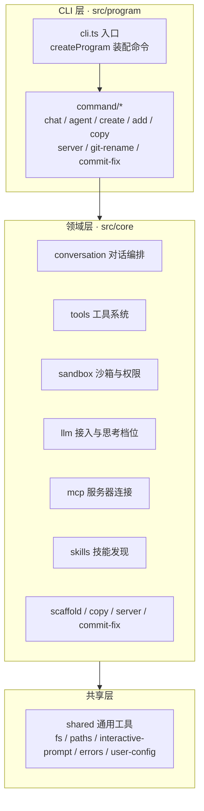
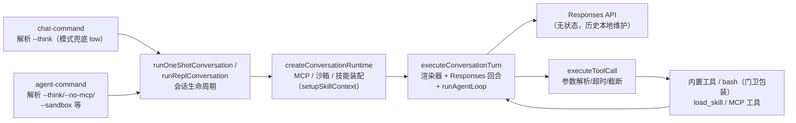
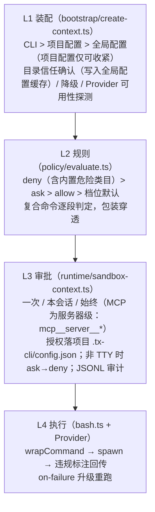

# 项目架构

> tx-cli：一个 Node.js 命令行工具，支持创建项目、添加模块、与大模型对话（含工具调用与沙箱管控）以及若干实用命令。

## 技术栈

| 类别      | 选型                                                  |
| ------- | --------------------------------------------------- |
| 语言与运行时  | TypeScript（ESM）+ Node.js ≥ 20.11                    |
| CLI 框架  | commander                                           |
| LLM 协议  | OpenAI 兼容 Responses API（`openai` SDK）               |
| 工具生态    | Model Context Protocol（`@modelcontextprotocol/sdk`） |
| 沙箱      | `@anthropic-ai/sandbox-runtime`（可插拔，见「沙箱与权限」）       |
| 构建 / 测试 | rollup / vitest                                     |
| 包管理     | pnpm                                                |

## 分层总览



依赖方向自上而下：命令层只做参数解析与分流，业务逻辑在领域层，跨模块复用的纯工具在共享层。命令与执行体分离（如 `registerChatCommand` / `runChatAction`），便于脱离 commander 单测。

## 目录结构

```text
src/
├── cli.ts                     # 进程入口：装配 program 并接管退出码
├── program/                   # CLI 层：命令注册（仅参数解析与分流）
│   └── command/               #   每个命令一个文件
├── core/                      # 领域层（协议类型内聚在各模块 types.ts）
│   ├── conversation/          # 对话编排（chat / agent 命令共用机制，模式即配置）
│   │   ├── chat.ts            #   chat 命令实现：CHAT_MODE + one-shot（单次）/ repl（多轮）入口
│   │   ├── agent.ts           #   agent 命令实现：AGENT_MODE + one-shot（单次）/ repl（多轮）入口
│   │   └── common/            #   会话机制：one-shot / repl 入口、turn/（execute-turn 回合
│   │                          #   wiring、agentic loop、Responses 适配、流式渲染）、
│   │                          #   runtime/（运行时装配、模式配置、技能装配）、repl/（输入与斜杠命令）
│   ├── tools/                 # 工具系统
│   │   ├── types.ts           #   Tool 接口（含 permission 权限声明、renderCall 调用渲染扩展点）
│   │   ├── executor.ts        #   执行器：参数解析、超时、8KB 截断
│   │   ├── permission.ts      #   权限门卫包装层（wrapToolWithPermission）
│   │   └── builtin/           #   内置工具：read_file / list_dir / glob /
│   │                          #   grep / web_search / write_file / edit_file（写侧，
│   │                          #   受可写边界管控）/ write_todos（agent 模式装配，
│   │                          #   工厂创建）/ bash（工厂创建，按需拼入）
│   ├── sandbox/               # 沙箱与权限（四层模型，见下文；模块详情见 src/core/sandbox/README.md）
│   │   ├── bootstrap/         #   L1 装配：create-context（createSandboxContext）、
│   │   │                      #   options（CLI/配置优先级合并）、trust（目录信任与降级）
│   │   ├── config/            #   配置 schema / 全局与项目配置加载校验
│   │   ├── policy/            #   L2 纯策略：规则语法、危险类目、判定引擎
│   │   ├── runtime/           #   L3 运行时：SandboxContext、fs 边界、审批器、
│   │   │                      #   档位边界构造、授权落盘、审计日志（JSONL）
│   │   ├── providers/         #   Provider 注册表 + srt / landlock / noop
│   │   ├── utils/             #   与业务无关的工具：glob 编译、路径匹配、命令切分、shell 引号
│   │   └── types.ts           #   领域类型与 Provider / Approver 接口
│   ├── llm/                   # LLM 接入：client、config 向导、thinking 适配（含档位解析）
│   ├── mcp/                   # MCP：config 解析、manager 连接管理、tool-adapter
│   ├── skills/                # 技能：discovery 扫描、catalog、load_skill 工具
│   ├── scaffold/              # 脚手架：templates 加载、render 渲染（create/add 共用）
│   ├── copy/                  # copy 命令的复制实现
│   ├── server/                # server 命令的静态文件服务
│   └── commit-fix/            # commit-fix 命令的 ONES 消息转换
└── shared/                    # 共享层：fs / paths / interactive-prompt（交互问答封装）/
                               # errors / user-config / warnings / string / text /
                               # serial-queue（串行执行队列）
```

## 对话链路（chat / agent 命令）



### 模式即配置

chat 与 agent 共用同一套会话机制（单次 one-shot / 多轮 repl、agentic loop、流式渲染、技能装配），两个命令的差异全部收敛为一份 `ConversationModeConfig`（`core/conversation/common/runtime/mode.ts`），由 `chat.ts` / `agent.ts` 各自提供，传给公共的 `runOneShotConversation` / `runReplConversation`——新增一种模式不需要新写编排逻辑。

**配置字段：**

| 字段 | 说明 |
|---|---|
| `basePrompt` | 模式人设（system 提示词底稿，技能元数据由 `buildSystemPrompt` 追加） |
| `modeLabel` | REPL 就绪面板展示标签 |
| `bashEnabled?` | bash 装配三态开关（单一说明源即本字段注释，见 `runtime/mode.ts`）：缺省跟随 CLI/配置/沙箱存在性；`false` 强制不装配，同时跳过 bash 专用 Provider 装载并抑制 bash 相关警告 |
| `todosEnabled?` | 是否装配 `write_todos` 任务清单 |
| `writeToolsEnabled?` | 是否装配 `write_file` / `edit_file`（缺省装配） |
| `maxIterations?` | 工具调用轮数上限（缺省 8） |
| `defaultThinkingLevel?` | 思考档位兜底 |

**两套模式配置的差异：**

| 维度 | chat | agent |
|---|---|---|
| 人设 | 轻量 AI 助手，简洁中文回答 | 任务执行 Agent：自主拆解步骤；优先 `write_file`/`edit_file` 而非 bash 重定向；高危操作先确认；3 步以上先 `write_todos` 且同一时刻仅一项进行中 |
| 写侧文件工具 | 代码强制剔除（`writeToolsEnabled: false`，只读语义写死在模式配置，不依赖沙箱档位） | 装配 |
| bash | 强制不装配（`bashEnabled: false`，跳过 Provider 装载；沙箱上下文仍创建，只读工具照常受 fs 边界管控） | 缺省装配（跟随 CLI/配置，受沙箱与审批管控，`--no-bash` 可关） |
| `write_todos` | 不装配 | 装配 |
| MCP | 硬编码关闭 | 缺省开启（`--no-mcp` 按次关闭） |
| 工具调用轮数上限 | 8 | 40 |
| 思考档位兜底 | `low` | `medium` |
| 沙箱命令行选项 | 不接收 | 接收 `--sandbox` / `--approval` / `--no-bash` / `--sandbox-missing` |

### agentic loop（runAgentLoop）

`core/conversation/common/turn/loop.ts` 的 `runAgentLoop` 是所有会话的心脏：整体运行在回合级取消上下文中（见下文），循环体不感知任何 LLM 细节，每轮通过 `runTurn(toolResults, toolsDisabled)` 回调向模式适配器（`responses-turn.ts`）要结果。单次会话与 REPL 每轮都经共用入口 `executeConversationTurn`（`turn/execute-turn.ts`）完成「渲染器 + Responses 回合 + agentic loop」的统一 wiring：

1. **请求回合**：`runTurn` 把上一轮的工具结果追加进历史、调用 LLM，返回两种 `TurnOutcome` 之一——`reply`（纯文本回答）或 `tool_calls`（工具调用清单）。
2. **正常退出**：收到 `reply` 即结束循环，返回最终回复。
3. **工具调用**：收到 `tool_calls` 时以 `Promise.all` 并发执行全部调用——并发但不乱序，结果数组顺序与请求一致；结果作为下一轮 `toolResults` 回传，进入下一轮迭代。
4. **软收敛**：迭代数达到 `maxIterations` 后进入收尾轮——先触发 `onSoftConverge` 黄字提示（「已达到工具调用轮数上限（N 轮），AI 将基于已有信息直接作答」），`runTurn` 收到 `toolsDisabled=true` 后**不下发工具定义**，模型无工具可用，只能基于已有历史直接作答。即达到上限不是硬截断，而是「收走工具再跑最后一轮」。
5. **防御性兜底**：软收敛轮模型若仍要求调用工具（理论上不可达），抛错终止而非死循环。
6. **幻觉工具**：模型调用了未注册的工具时不中断会话，转为 `ok:false` 失败结果（「未注册的工具：xxx」）回传模型自行纠正。

### 无状态 Responses

LLM 调用走 OpenAI 兼容 Responses API 的**无状态模式**（`core/llm/client.ts` 的 `streamResponse`）：`store: false` 关闭服务端会话存储，`instructions`（system 提示词）与完整 `input` 历史**每轮全量重传**。这样不依赖服务端会话能力，任何支持该接口的 OpenAI 兼容服务都能接入。

- **本地历史**（`responses-turn.ts`）：历史数组由会话持有——one-shot 为函数局部变量；REPL 每轮用户输入新建 turn，但共享同一 `history` 数组引用。历史项三类：user/assistant 消息、`function_call`（工具调用）、`function_call_output`（工具结果），后两者靠 `callId` 配对。
- **每轮追加**：用户输入 push 为 user message → 上一轮工具结果追加为 `function_call_output` → 响应到达后 assistant 回复与 `function_call` 逐项追加。
- **流式事件**（`client.ts`）：`output_text.delta` 累积正文并回调渲染；`reasoning_text.delta` 与 `reasoning_summary_text.delta`（分别对应 openai 开源系与官方模型的思考输出）统一路由到思考渲染，渲染层不感知模型差异；`output_item.done` 中 `type === "function_call"` 的项收集为工具调用。工具定义以 `type: "function"`、`strict: false` 下发。HTTP 错误经 `toCliError` 映射为中文 `CliError`（401/404/429/网络失败等）。

### 流式渲染

`renderer.ts` 用 `lastStreamKind`（`reasoning` / `content` / undefined=行首）跟踪当前输出流，实现思考与正文的分流：

- **思考增量**：进入思考块先输出暗色 `…… ` 标记，随后增量一律暗色（dim）输出；模型未返回思考增量时零额外输出（非思考模型零噪音）。
- **正文增量**：先 `endThinking()`（补换行结束思考块）再原样输出正文（无颜色）。
- **边界补换行**：`ensureNewline()` 保证从流式正文切换到非流式输出（工具调用提示、软收敛提示）前不粘连。
- **工具调用提示**：`→ 调用 name(arguments)`，优先使用工具自定义的 `renderCall`（参数为合法 JSON 对象时，如 `write_todos` 的清单视图 `☐ 待办 / ◐ 进行中 / ☑ 已完成`），失败回退默认格式。

### 回合级取消传播

`shared/turn-cancel.ts` 基于 `AsyncLocalStorage` 实现回合级取消标记（`{ cancelled: boolean }` 状态对象，非 token 方案）：`runWithTurnCancellation` 包裹整个 agentic loop，同一轮内所有并发工具执行链共享同一状态对象，REPL 多轮之间互不影响。

- **置位点**（`markTurnCancelled`）：
  1. 交互问询（审批/升级确认）的 `onCancel` 回调中**同步**置位再抛 `CancelError`——同步置位保证取消标记早于一切 Promise 传播链，串行队列中排队任务启动时必然可见，避免微任务时序竞争；
  2. loop 捕获工具执行中的 `CancelError` 时兜底置位。
- **检查点**（`throwIfTurnCancelled`）：
  1. 串行队列任务**真正启动前**（门卫 `invoke` 开头）——取消后同轮排队任务不再执行；
  2. `guard` 审批问询前——取消后不再弹出新的审批窗。
- **边界**：JS 无法终止正在执行的 Promise，正在执行的工具照常完成，但结果随整体 reject 丢弃。

### 任务清单与 MCP 生命周期

- **任务清单**（agent 模式）：`write_todos` 全量替换式维护会话内计划（对标 TodoWrite），状态存工具实例闭包、不持久化；对 3 步以上的任务，系统提示词要求模型先建清单且同一时刻仅一项进行中；REPL 以 `/todos` 随时查看。
- **MCP 与沙箱同生命周期**：随会话创建、`finally` 中统一释放。
- **MCP roots capability**：客户端声明 roots 能力并响应 `roots/list`，按沙箱档位联动下发目录白名单——read-only 档不放权（返回空），其余档位下发项目根与 OS 临时目录（均经 realpath 规范化为 file:// URI，规避 macOS 符号链接前缀失配）；支持该协议的服务器（如 chrome-devtools-mcp）将其文件白名单与 tx-cli 工作区对齐，不支持的服务器无感知。

### 失败隔离

- **工具错误不进循环**：工具抛错由执行器转为 `ok:false` 结果回传模型自纠（见「工具系统」），不中断会话。
- **REPL 单轮错误不终止会话**：用户取消（`CancelError`）回滚本轮历史（history 截回本轮起点）提示后继续；LLM/业务错误（`CliError`）红字提示后会话继续；未预期异常仍然上抛（不掩盖代码 bug）。
- **one-shot 直接终止**：单次会话不 catch 业务错误，`finally` 清理运行时后错误上抛，由 CLI 层接管退出码。

## 深度思考（thinking）处理方案

深度思考的协议差异统一收敛在 `core/llm/thinking.ts` 适配层，对话编排层只面向统一的「档位」概念。

### 档位模型

四档思考强度：`off` / `low` / `medium` / `high`，取值优先级：

```text
命令行 --think  >  配置文件 llm.thinkingLevel（项目 > 全局）  >  模式兜底（chat 为 low，agent 为 medium）
```

- 解析链路的单一入口是 `resolveThinkingLevel`（`core/llm/thinking.ts`）：CLI 与配置均未指定时取模式兜底，agent 模式未指定兜底时回退 `medium`。
- `chat` 命令为轻量只读问答：兜底档位比 `agent` 更轻（`low`，`agent` 为 `medium`）。
- 档位校验前置（`parseThinkingLevel`，与 `parseThinkingStyle` 共用枚举解析实现）：非法值在对话开始前报错退出，不带着错误配置发请求。
- REPL 中可用 `/think` 内联命令会话内切换（无参查看、带参下一轮生效）。

### 协议风格适配

不同服务对思考字段的协议互不兼容，适配层按「风格」翻译为请求附加字段：

| 风格                     | 判定来源                                              | 请求字段                                 | 档位折算                     |
| ---------------------- | ------------------------------------------------- | ------------------------------------ | ------------------------ |
| `reasoning_effort`（默认） | 未命中推断规则时兜底                                        | `reasoning.effort`                   | 四档直传；`off` 不发字段          |
| `thinking`             | baseUrl 含 `volces.com` / `doubao` / `bigmodel.cn` | `thinking.type: enabled \| disabled` | 开关式：非 `off` 均折算为 enabled |
| `enable_thinking`      | baseUrl 含 `dashscope.aliyuncs.com`                | `enable_thinking: boolean`           | 开关式：非 `off` 均折算为 true    |
| `none`                 | 服务不支持                                             | 不下发                                  | 任意档位均不发思考字段              |

- **显式配置优先**：`llm.thinkingStyle` 显式指定时跳过 baseUrl 推断。
- **高级映射**：`llm.thinkingEffortMap` 可按档位自定义下发值（如把 `high` 映射为服务端自定义字符串），优先于内置映射。
- **`off` 最大化兼容**：`off` 在 reasoning_effort / none 风格下不产生任何附加字段，避免向不支持思考扩展的服务发送多余字段。

### 折算警告（warnThinkingFallback）

服务能力与用户档位不对齐时提前黄字提示，避免用户误以为 `high` 等档位真实生效：

- `none` 风格：提示思考字段不会下发（建议换 reasoner 类模型）。
- 开关式风格且档位非 `off`：提示 low/medium/high 均按开启折算。

### 思考内容的流式渲染

思考内容以暗色流式输出（以 `……` 标记开始），未返回思考内容则不产生任何额外输出；实现细节见「对话链路 · 流式渲染」——渲染层通过统一回调消费思考增量，不感知不同服务的思考事件差异。

## 工具系统

所有工具实现统一的 `Tool` 接口（`ToolDefinition` + `execute` + 可选 `timeoutMs` / `permission`）：

```ts
interface Tool extends ToolDefinition {
  timeoutMs?: number;
  permission?: {
    capabilities: Array<"fs.read" | "fs.write" | "net" | "exec">;
    ruleKey(args): string;   // 如 bash(git status)
    serial?: boolean;        // 串行工具在会话级队列中依次执行
    mcp?: {                  // MCP 工具元信息（服务器展示名 / 规则键段 / 只读标记）
      server: string;
      serverKey: string;
      readOnly: boolean;
    };
  };
  execute(args): Promise<ToolOutput>;
}
```

### 工具装配（setupSkillContext）

`core/conversation/common/runtime/skill-context.ts` 按固定顺序拼接工具清单，**不支持运行时动态注册**：

1. **内置静态清单**（`tools/builtin/index.ts`）：`read_file`、`list_dir`、`glob`、`grep`、`web_search`、`write_file`、`edit_file` 共 7 个；模式关闭写侧工具时（chat）按名单剔除 `write_file` / `edit_file`；
2. **`load_skill`**：仅当 `discoverSkills()` 扫描到技能时装配——空技能时不多下发无用工具定义；
3. **`write_todos`**：模式 `todosEnabled` 时装配（agent），工厂创建、状态存工具实例闭包；
4. **bash**：沙箱上下文存在且模式允许时装配，工厂创建、注入 `SandboxContext`；
5. **外部工具**：MCP 工具经适配后由此拼入。

装配后校验工具重名（重名视为代码 bug，直接抛 `CliError`）；**存在沙箱上下文时，全部工具经 `wrapToolWithPermission` 门卫包装**（未声明 `permission` 的工具原样放行）。

### 执行器（executeToolCall）

`core/tools/executor.ts`，所有工具调用的统一入口：

- **参数解析**：`JSON.parse` 失败不抛出，转为 `ok:false`（「参数不是合法的 JSON 对象」）回传模型重试。
- **超时**：全局默认 30 秒，工具可声明 `timeoutMs` 覆盖（MCP 工具 60s、bash 605s）；计时**可暂停**——审批/升级问询前 `pauseToolTimeout()`、问询结束 `resumeToolTimeout()`，用户思考时间不计入超时，避免「超时误判 + 迟到授权后任务继续执行」的重复执行竞态。
- **输出截断**：超 8192 字符保留前段并追加截断说明（含原文字符数），防止大输出撑爆上下文。
- **错误转输出**：任何非取消异常转为 `ok:false`（「工具执行失败: ...」）回传模型自纠；唯一例外 `CancelError`（如审批中 Ctrl+C）原样上抛走取消流程。

### 权限门卫（wrapToolWithPermission）

`core/tools/permission.ts`：

- 未声明 `tool.permission` 的工具**原样返回**（零破坏渐进迁移）；声明了的包装 `execute`——模型可见的工具定义不变，仅执行被拦截。
- 声明 `serial: true` 的工具（bash、`write_file` / `edit_file`）的「判定 + 审批 + 执行」全程在会话级串行队列（`SerialQueue`）中依次执行，避免并发读改写竞态；队列前序失败不阻断后续。
- 包装后的执行序：取消检查 → 生成规则键 `ruleKey(args)` → `sandbox.guard(...)`（L2 规则判定 + L3 审批）→ fs 边界校验 → 实际执行。
- **fs 边界校验**：fs 工具是进程内代码、不经沙箱进程，故在规则放行后按档位 TierConfig 逐路径校验 `checkFsRead` / `checkFsWrite`，命中即拒绝并审计。

### MCP 工具适配（tool-adapter）

远端 MCP 工具经适配成为标准 `Tool`：命名带 `mcp__<服务器名>__<工具名>` 前缀隔离；适配时读取远端工具定义的 `annotations.readOnlyHint`，把服务器名、净化后的规则键段与只读标记一并下传权限门卫——这决定该工具在 L2 走「默认放行」（只读）还是「默认审批」（可写）类目。

## 沙箱与权限（四层模型）

> 模块内部目录职责、核心概念与推荐阅读顺序见 [src/core/sandbox/README.md](../src/core/sandbox/README.md)。

三档沙箱（`SandboxLevel`）× 审批策略（`ApprovalPolicy`）正交：

| 档位                   | 文件系统                                | 网络               | Provider |
| -------------------- | ----------------------------------- | ---------------- | -------- |
| `read-only`（默认）      | 全禁写，禁读 `~/.ssh` `~/.aws` `~/.gnupg` | 全禁               | srt      |
| `workspace-write`    | 可写 cwd 与临时目录，禁写 `.env` `*.pem` 等    | 按 allowedDomains | srt      |
| `danger-full-access` | 无隔离                                 | 无限制              | noop（直通） |

审批策略：`always-ask`（每次询问）/ `on-failure`（默认，沙箱拦截失败时提供升级重跑）/ `never`（仅信任目录生效）。MCP 工具不经 OS 沙箱，判定独立于档位：只读工具默认放行，可写工具默认 ask（`never` 下按拒绝处理）。



### L1 装配（bootstrap/create-context.ts · createSandboxContext）

沙箱上下文随会话创建，流程：

1. **配置装载**：加载全局 `~/.tx-cli/config.json` + 项目 `<cwd>/.tx-cli/config.json` 两份 sandbox 配置，按能力感知语义合并（项目仅可收紧，见下文「信任模型」）；生效档位/审批取 `CLI 选项 ?? 配置文件值`，即优先级 **CLI > 项目配置 > 全局配置**（链路说明源 `bootstrap/options.ts` 的 `ResolvedOptions`）。
2. **enabled 开关**：配置关闭沙箱时不装配 bash、上下文返回 undefined；但 CLI 显式传 `--sandbox <level>` 视为强制启用（覆盖配置的关闭），此时再传 `--approval` 等选项会警告不生效。bash 装配开关与沙箱上下文解耦：`--no-bash` 只移除 bash 工具，fs 门卫对其他工具照常生效；chat 等强制无 bash 的模式经 `bashForcedOff` 跳过 Provider 装载并抑制 bash 相关警告。
3. **目录信任确认**：仅当 `danger-full-access` 档 / `never` 审批**来自配置文件**（CLI 未显式传入）且当前目录不在信任目录内时触发交互确认——确认则去重写入全局 `trustDirectories` 缓存并按原值生效；拒绝/取消/非交互则降级（full → workspace-write、never → on-failure）并黄字告警。
4. **Provider 探测**：`danger-full-access` 直通 noop；否则按配置取 Provider 并探测 `isAvailable()` + `initialize()`——不可用时默认 fail-closed（bash 返回失败并提示），`--sandbox-missing allow` 显式降级为 noop 无隔离执行（规则与审批仍生效）。
5. **提前警告**：bash 装配且 workspace-write 档且网络白名单为空时，提前提示所有 bash 联网将被 403 拒绝。

### L2 规则判定（policy/）

纯函数策略层，无 IO：

- **判定优先级**：`deny`（含内置危险类目）> `ask` > `allow` > 档位默认；bash 复合命令逐段判定，任一段命中 deny 整条拒绝、任一段命中 ask 整条进入审批。
- **包装穿透**：deny/ask 匹配时剥离 `FOO=bar` / `env` / `nohup` / `xargs` 包装看真实命令（allow 不穿透，防止借包装放行危险命令）。
- **规则语法**：`Bash(git push:*)` 前缀、`Bash(git status)` 精确、`Bash(git log *)` glob、`Read(/src/**)` 路径、`WebSearch` 整工具。
- **规则名别名归一化**：`Read`→`read_file`、`WebSearch`→`web_search`、`ListDir`→`list_dir`、`Write`→`write_file`、`Edit`→`edit_file`（Claude Code 风格短名 ↔ 内部工具名），规则键与规则两侧都归一化后匹配。
- **MCP 类目**：分 `mcp-read`（`readOnlyHint === true` 且未声明 `destructiveHint`）与 `mcp-tool`（可写）——`mcp-read` 未命中规则时默认放行（`always-ask` 策略下仍询问），`mcp-tool` 默认审批；显式 `ask`/`deny` 规则始终优先。
- **内置危险类目**（可 `sandbox.builtinDangerRules: false` 关闭）：`rm -rf`、`sudo/su`、`chmod 777`、磁盘写入、`curl|sh`、`git push -f`、保护路径。

### L3 审批与授权（runtime/）

- **审批触发**：`guard` 中 L2 判定为 `ask` 才进入审批——非交互环境（非 TTY / CI）一律按拒绝处理（denied-noninteractive）；交互环境则暂停工具计时 → 取消检查 → `approver.ask`（实现在 `runtime/interactive-approver.ts`）→ 恢复计时。用户 deny 记审计并回传「用户拒绝了本次命令执行」。
- **授权粒度四级**：本次 / 本会话 / 始终允许（落盘）/ MCP 服务器级（落 `mcp__<server>__*`，同服务器其余工具不再逐个询问；不覆盖显式 ask 规则）。
- **落盘规则**：「始终允许」写入项目空间 `<cwd>/.tx-cli/config.json`（仅当前项目生效）——MCP 授权落 `mcp.rules.allow`，其余落 `sandbox.rules.allow`；规则键优先复用命中的显式规则，无可复用时自动派生（bash 取命令前缀，如 `bash(git status)` → `bash(git status:*)`；其余取工具名）。本会话授权仅存内存，并把命中的 ask 规则移入 allow。
- **审计**：所有拦截与审批判定追加一行 JSON 到 `~/.tx-cli/sandbox-audit.jsonl`。
- **/permissions 内联命令**（REPL）：只读展示档位、审批策略、Provider、fs 边界与三段规则（allow 含会话授权与「始终允许」的持久授权）。

### L4 执行（bash.ts + Provider）

- **wrapCommand**：把命令交给 Provider 注入沙箱执行包装后 spawn（`commandId` 用于违规归因，`commandText` 为用户可见命令文本）。
- **违规标注**：`annotateStderr` 把沙箱违规说明标注回 stderr，并从违规事件存储取该命令的违规行，供审计与展示。
- **on-failure 升级重跑**：沙箱拦截导致命令失败时，提供「升级放权重跑」的交互选项。

### 权限纳管范围

bash（exec，串行）、read_file / list_dir / glob / grep（fs.read，规则键以绝对路径为主体）、write_file / edit_file（fs.write，串行，read-only 档被可写边界拒绝）、web_search（net，规则键 `web_search(关键词)`）、MCP 工具（整工具级键 `mcp__server__tool`，按 `readOnlyHint` 区分只读/可写，只读仅标注 net，其余保守标注 net+exec）。无沙箱会话（`sandbox` 为 undefined）不包装、行为不变。

### capabilities 禁网语义

工具声明的能力（如 net）随 guard 链路传入规则判定；read-only 档承诺禁网，net 工具未命中规则时默认 ask——OS 沙箱只拦子进程，进程内网络调用不受边界约束，故由审批层兜底（`never` 策略下直接 deny）；声明 `readOnlySafe` 的无副作用只读检索工具（`web_search`）例外，口径对齐 mcp-read 默认 allow（`always-ask` 仍 ask）。

### 信任模型（防自证信任）

项目 `.tx-cli/config.json` 随仓库分发，不可作为权限放大的凭据——两级合并为能力感知语义：项目配置仅可收紧（放宽档位/审批、关沙箱/内置危险规则/审计、开 bash 及 `trustDirectories` / `writableRoots` / `allowedDomains` 等放宽项被忽略并告警；`rules.allow` 保持并集以承载会话授权落盘）；信任目录仅全局配置可提供，配置文件来源的 `danger-full-access` / `never` 在非信任目录时先交互确认信任（流程见 L1 第 3 步），未确认则降级；CLI 显式传入的危险值视为用户本人意图，不降级不询问。

### Provider 插拔（核心解耦）

`SandboxProvider` 接口（`isAvailable` / `initialize` / `wrapCommand` / `annotateStderr` / `dispose`），注册表编译期固定。`providers/srt.ts` 是全库唯一 import `@anthropic-ai/sandbox-runtime` 的文件；`providers/landlock.ts` 走外部 helper 方案（Node 无法直接发起 Landlock syscall，用户自装 `landlock-exec` 到 PATH 或 `~/.tx-cli/bin`，或经 `TX_SANDBOX_LANDLOCK_HELPER` 指定路径；denyRead 子树排除由应用层兜底）——新增沙箱实现只需实现 Provider 并注册，上层无感知。

## 配置文件

`~/.tx-cli/config.json`（0600，`shared/user-config.ts` 统一读写，进程内缓存）：

| 段            | 职责                                   | 解析模块                     |
| ------------ | ------------------------------------ | ------------------------ |
| `llm`        | 模型接入（baseURL、apiKey、thinkingLevel 等） | `core/llm/config.ts`     |
| `mcpServers` | MCP 服务器（stdio/http）                  | `core/mcp/config.ts`     |
| `mcp.rules`  | MCP 工具专属规则（allow/ask/deny，规则名可省略 `mcp__` 前缀） | `core/sandbox/config/load.ts` |
| `sandbox`    | 沙箱（档位/策略/规则/文件系统/网络/bash）            | `core/sandbox/config/load.ts` |

辅助文件：`~/.tx-cli/sandbox-audit.jsonl`（沙箱审计日志）；「始终允许」授权落项目空间 `<cwd>/.tx-cli/config.json`（结构与全局配置同构，装配时加载 `sandbox.rules` 与 `mcp.rules` 并提示）；技能目录为 `~/.tx-cli/skills` 与 `./.tx-cli/skills`。

配置解析遵循统一范式：坏项跳过 + 中文警告（失败隔离），不中断会话。

## 扩展点

| 需求         | 入口                                                                                         |
| ---------- | ------------------------------------------------------------------------------------------ |
| 新增命令       | `src/program/command/` 新建文件并在 `program/index.ts` 的 registrars 注册                           |
| 新增内置工具     | `src/core/tools/builtin/` 实现 `Tool` 接口并加入 `builtinTools`；需权限管控则声明 `permission` 字段（自动被门卫包装） |
| 新增沙箱实现     | `src/core/sandbox/providers/` 实现 `SandboxProvider` 并在 `providers/registry.ts` 注册                     |
| 新增模板       | `template/` 目录（create/add 共用脚手架流程 `core/scaffold`）                                         |
| 接入新 LLM 能力 | 思考档位等协议差异统一收敛在 `core/llm/thinking.ts` 适配层                                                  |
